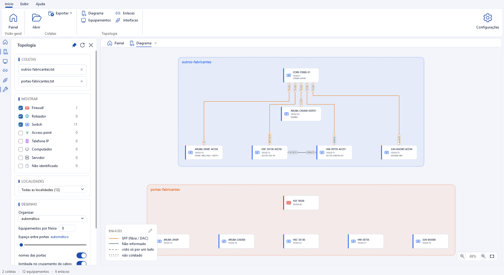
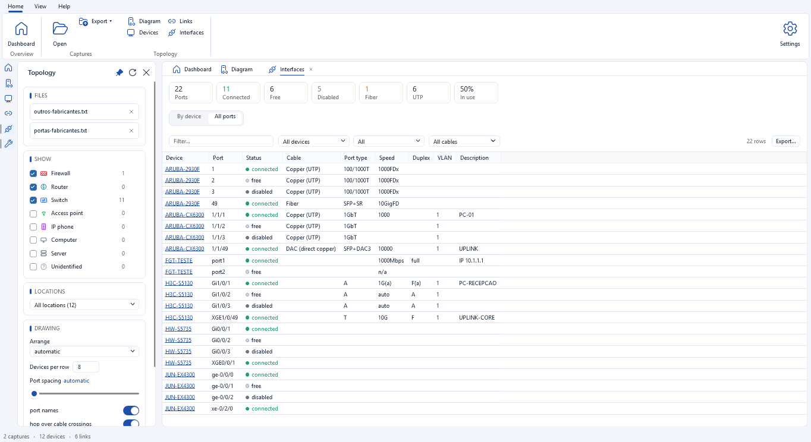

# Topologia CDP/LLDP

Lê coletas CDP/LLDP dos equipamentos e desenha a topologia da rede. Funciona sem internet.

## Downloads

As versões são publicadas em **Releases**.

## Telas / Screenshots

Fotos da versão 0.10.0, com dados fictícios. / Screenshots of version 0.10.0, with fictitious data.

**Diagrama da rede** — o mapa desenhado a partir das coletas CDP/LLDP, separado por coleta.  
**Network diagram** — the map drawn from the CDP/LLDP captures, grouped by capture.

**Tema escuro, em inglês** — a mesma tela com o tema escuro e a interface em inglês.  
**Dark theme, in English** — the same screen with the dark theme and the English interface.

**Equipamentos** — lista dos equipamentos encontrados, com modelo, versão e inventário.  
**Devices** — list of the devices found, with model, version and inventory.

**Interfaces** — todas as portas com estado, tipo de cabo, velocidade e VLAN.  
**Interfaces** — every port with status, cable type, speed and VLAN.

## Licença

**Uso gratuito — todos os direitos reservados.**
Pode usar de graça, inclusive no trabalho. Não pode modificar, copiar para outras pessoas nem vender.
Termos de Uso completos em **[LICENSE](LICENSE)**. As licenças das bibliotecas de terceiros vão dentro do zip.

## Autor

**Fabio Fernando Giacomelli** © 2024-2026 — [LinkedIn](https://www.linkedin.com/in/fabio-g-23a590168/)
