
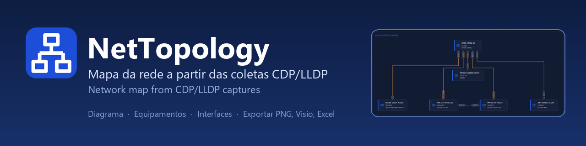

    

<b>Da coleta CDP/LLDP ao mapa da rede em segundos.</b> <i>From CDP/LLDP captures to a network map in seconds.</i>

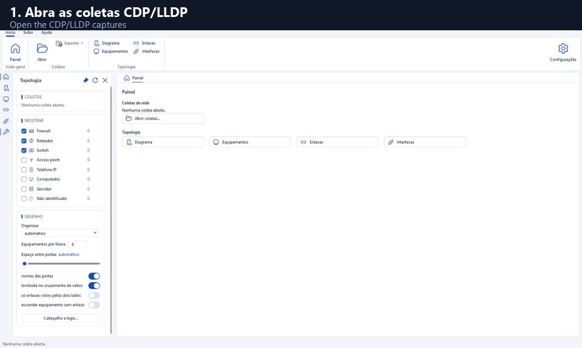

## O que é / What it is
O NetTopology é para quem cuida de rede: lê as saídas de `show cdp/lldp neighbors` dos switches, roteadores e firewalls e desenha sozinho o mapa de quem está ligado em quem, porta por porta. Mostra também a lista de equipamentos e de interfaces e exporta tudo para imagem, Visio, draw.io e Excel. Funciona sem internet.
*NetTopology is for network teams: it reads the `show cdp/lldp neighbors` output of switches, routers and firewalls and draws the map of what is connected to what, port by port. It also lists devices and interfaces and exports everything to image, Visio, draw.io and Excel. Works offline.*

## Destaques / Highlights
| | |
|---|---|
| **Mapa automático** — abra as coletas e o diagrama aparece, com o nome das portas em cada cabo. *Automatic map — open the captures and the diagram appears, with port names on every cable.* | 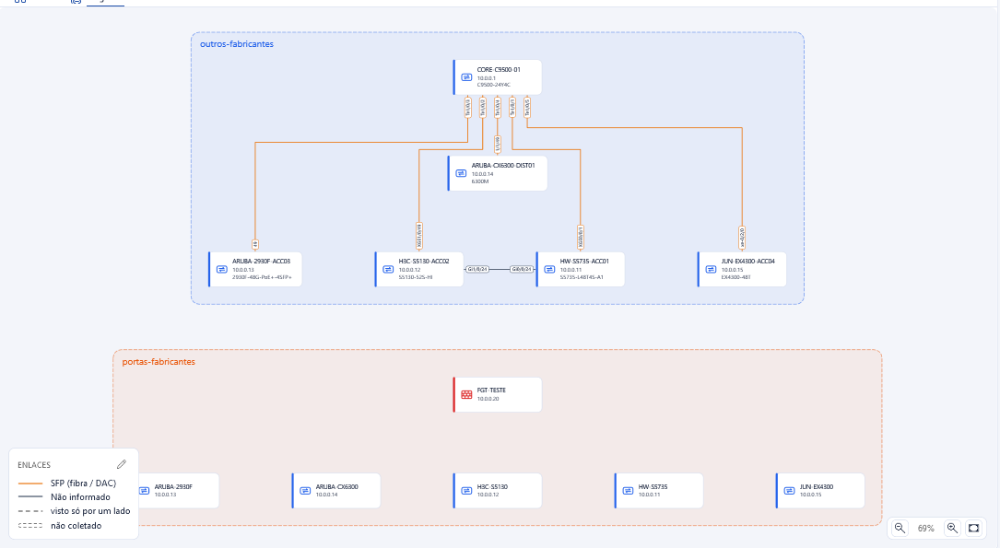 |
| **Organizado do seu jeito** — por camada (perímetro, core, distribuição, acesso), por local ou por tipo. *Arranged your way — by layer (perimeter, core, distribution, access), by site or by type.* | 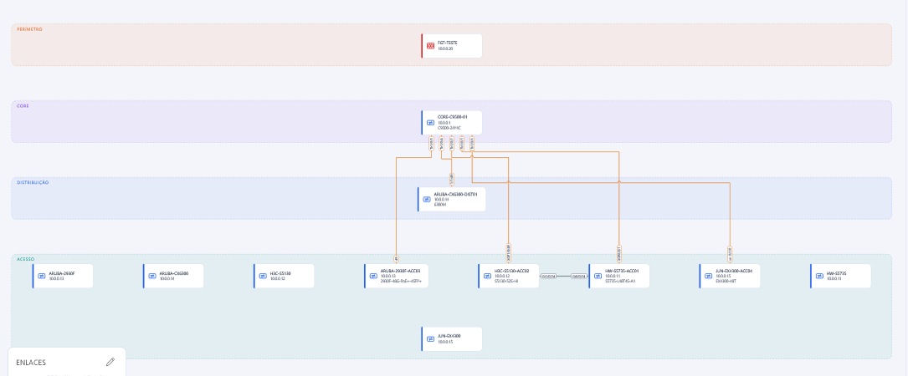 |
| **Detalhes num clique** — IP, modelo, versão, portas e hardware de cada equipamento. *Details in one click — IP, model, version, ports and hardware of every device.* | 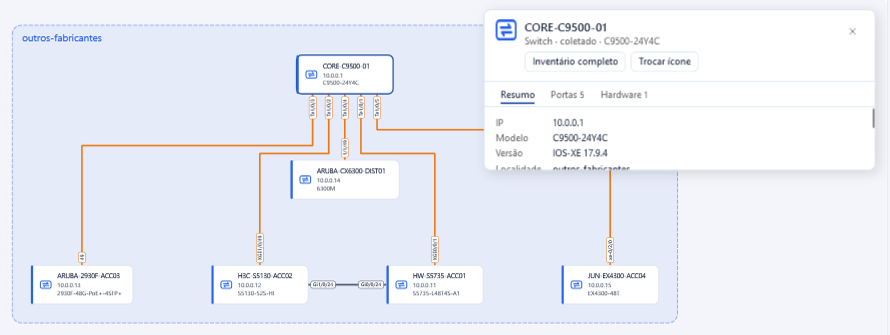 |

## Como funciona / How it works
1. Rode os comandos de `comandos-coleta.txt` nos equipamentos e salve a saída em arquivos de texto. / *Run the commands in `comandos-coleta.txt` on the devices and save the output to text files.*
2. Abra os arquivos no NetTopology. / *Open the files in NetTopology.*
3. Veja o mapa, ajuste a organização e exporte. / *See the map, adjust the layout and export.*

## Funcionalidades / Features
| Recurso / Feature | O que faz / What it does |
|---|---|
| Diagrama / Diagram | Desenha equipamentos e enlaces com as portas de cada lado. / *Draws devices and links with the ports on each side.* |
| Vários fabricantes / Multi-vendor | Lê CDP e LLDP de diferentes fabricantes no mesmo mapa. / *Reads CDP and LLDP from different vendors in one map.* |
| Organizar / Arrange | Automático, por camada, por local ou por tipo de equipamento. / *Automatic, by layer, by site or by device type.* |
| Equipamentos / Devices | Lista com modelo, versão, nº de série e inventário completo. / *List with model, version, serial number and full inventory.* |
| Interfaces | Todas as portas com estado, cabo, velocidade, duplex e VLAN. / *Every port with status, cable, speed, duplex and VLAN.* |
| Exportar / Export | PNG, SVG, Visio (.vsdx), draw.io, Excel, CSV e JSON. / *PNG, SVG, Visio (.vsdx), draw.io, Excel, CSV and JSON.* |
| Pasta vigiada / Watched folder | Lê sozinho as coletas novas que chegam numa pasta. / *Automatically reads new captures dropped in a folder.* |
| Tema e idioma / Theme and language | Claro ou escuro, português ou inglês. / *Light or dark, Portuguese or English.* |
| Atualização / Updates | Avisa quando há versão nova e atualiza com um clique. / *Tells you when a new version is out and updates in one click.* |

## Galeria / Gallery
| | |
|---|---|
|  Mapa da rede / *Network map* | 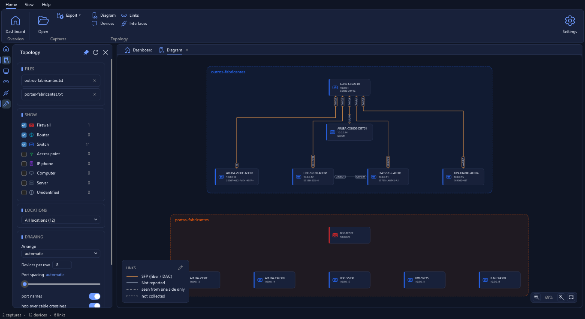 Tema escuro, em inglês / *Dark theme, in English* |
| 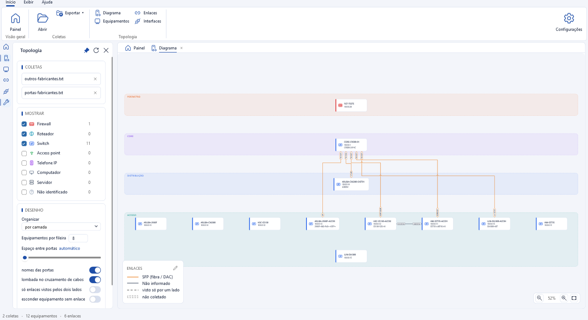 Organizado por camada / *Arranged by layer* | 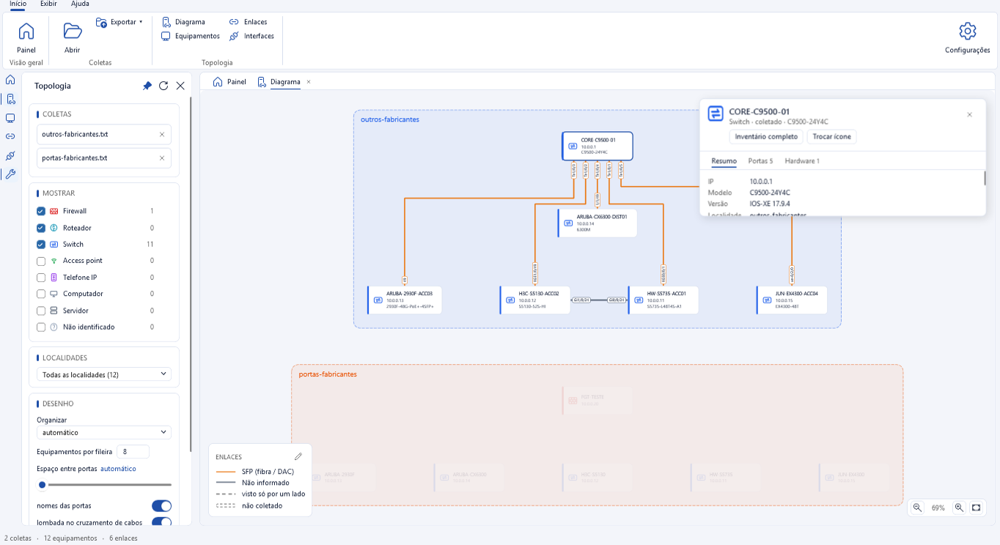 Detalhes do equipamento / *Device details* |
| 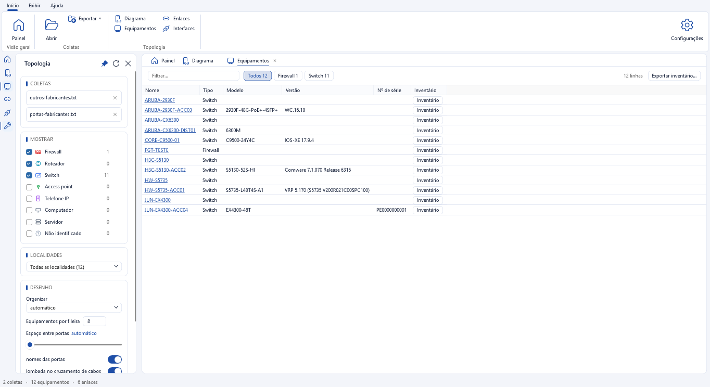 Lista de equipamentos / *Device list* |  Todas as interfaces / *All interfaces* |
| 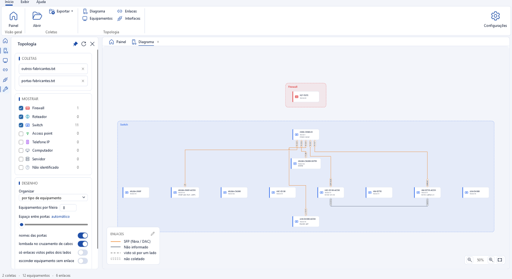 Organizado por tipo / *Arranged by type* | 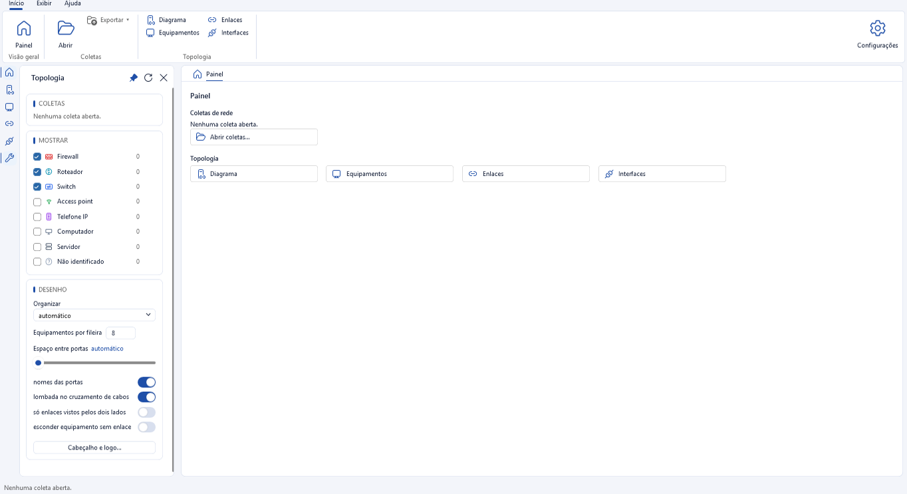 Painel inicial / *Start panel* |

Fotos da versão 0.10.0 com dados fictícios. / *Screenshots of version 0.10.0 with fictitious data.*

## Baixar / Download
- [Instalador / Installer (.msi) e Portátil / Portable (.zip) — versão mais nova / latest](https://github.com/Dorflex-DD/TopologiaCDP-LLDP/releases/latest)

Windows 10/11 x64 · [.NET 11 Desktop Runtime](https://dotnet.microsoft.com/download/dotnet/11.0) · O instalador é só para você, sem pedir administrador; o portátil é só descompactar. / *The installer is per-user, no admin needed; the portable just unzips.*

## Novidades / What's new — v0.10.0
- Nova tela inicial com painel e ações de topologia na faixa de comandos. / *New start screen with panel and topology actions on the ribbon.*
- Configurações organizadas por assunto, com pesquisa e ajuda. / *Settings organized by topic, with search and help.*
- Mapas com muitos equipamentos calculados mais rápido. / *Faster layout for maps with many devices.*

## Licença / License
**Uso gratuito — todos os direitos reservados.** Pode usar de graça, inclusive no trabalho. Não pode modificar, copiar para outras pessoas nem vender. Termos completos em [LICENSE](LICENSE).
*Free to use — all rights reserved. Free to use, including at work. You may not modify, redistribute or sell it. Full terms in [LICENSE](LICENSE).*

© 2024-2026 Fabio Fernando Giacomelli · [LinkedIn](https://www.linkedin.com/in/fabio-g-23a590168/)
